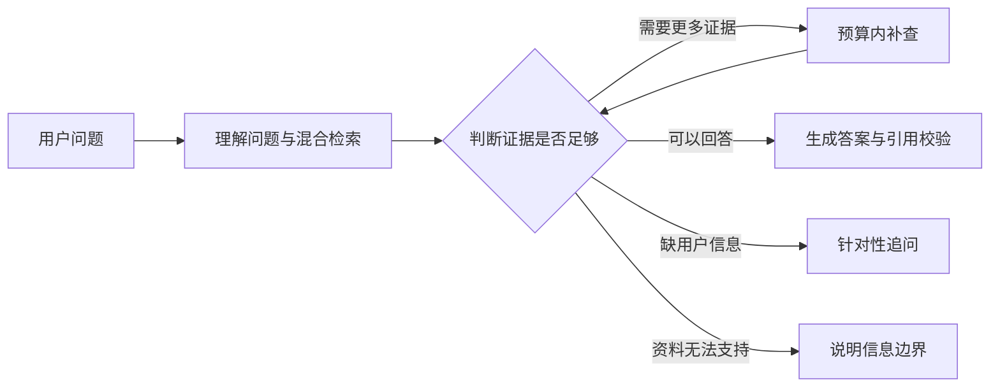

# MiniAssist

基于 **LangGraph + Elasticsearch 混合检索**的中文产品技术支持 RAG，以 DJI Mini 4 Pro 为主要场景，帮助用户找到适用于自己设备、版本和使用条件的答案。

## 项目背景

产品资料分散在手册、FAQ、兼容说明和更新记录中。用户提出“遥控器连不上”“升级时异常”等问题时，正确回答往往需要结合多处信息，并区分型号、版本和操作前提。

MiniAssist 围绕这一问题，实现从文档解析、混合检索到多轮问答与质量评估的完整流程：有依据时回答，缺证据时有限补查，缺用户信息时追问，超出资料能力时说明边界。

## 核心架构

**技术栈：Python · LangGraph · Elasticsearch · BGE · DeepSeek · RAGChecker**

| 模块 | 实现重点 |
| --- | --- |
| 文档处理 | 按章节、段落和表格结构切分；超长内容递归拆分，保留表头、必要上下文及原文坐标 |
| 混合检索 | Elasticsearch BM25 与 BGE 中文向量双路检索，应用层加权 RRF 融合 |
| 流程编排 | LangGraph 管理理解、检索、判断、补查、生成与追问；最多一轮、两条额外查询 |
| 引用校验 | 校验引文原文位置，支持表格行与分类标题的来源追溯；协议错误在有限预算内修复 |
| 质量评估 | 结合人工答案审核、必需证据覆盖与 RAGChecker，分别观察回答质量、检索缺口和生成问题 |

## 技术取舍

项目通过固定、递归与结构切分对照，以及检索和生成消融实验定位问题，区分“没检索到”“检索到了但没用好”和“引用协议失败”。

问答策略也比较了模型自主补查、规则辅助补查，以及更复杂的 aspect 覆盖检查与生成后 claim 检查。复杂方案在既有验证集上未获得质量收益，策略阶段平均 token 消耗达到基线的 **2.22 倍**，因此 V1 保留较简单的 B 策略，并修复公共引用协议。

当前向量检索采用 ES 精确余弦计算，尚未验证大规模 ANN 性能。引用校验能检查来源位置，但不等于证明每个推断都正确。

## 评估结果

| 评估范围 | 人工审核 | RAGChecker |
| --- | --- | --- |
| 冻结版完整测试：60 题，各运行 3 次 | 169 正确、2 部分、9 技术失败；完整正确率 **93.89%** | 对 171 份交付答案评分，F1 三轮均值约 **65.73%** |
| 协议修复后回归：6 道已暴露问题，各运行 3 次 | **18/18 正确**，0 技术失败 | F1 **75.21%**，faithfulness **92.41%** |

## 当前进度

V1 已具备命令行多轮问答、可追溯引用和完整评估记录。目前是单机原型，会话保存在进程内；后续优先完善独立部署与演示入口。